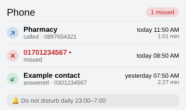

# FRITZ!Box Call Card

The current call and a call list for the **AVM FRITZ!Box call monitor** integration.



- **Live:** ringing (pulsing red), on a call (green), dialling (blue), with a running timer.
- **Call list** from the recorder history: answered, dialled, not reached and missed – with name from the phone book, number, time and duration.
- **Missed calls** are counted until you tap the badge (stored per browser).
- Optional **do-not-disturb** hint, e.g. when the FRITZ!Box blocks ringing at night.
- English and German texts.

## Installation

**HACS (recommended):** open HACS, search for **FRITZ!Box Call Card**, install it and reload the browser.

If it does not show up yet: HACS → ⋮ → *Custom repositories* → add this repository with type *Dashboard* → install → reload the browser.

**Manual:** copy `fritzbox-call-card.js` to `config/www/` and add `/local/fritzbox-call-card.js` as a JavaScript module resource.

Requires the [FRITZ!Box call monitor integration](https://www.home-assistant.io/integrations/fritzbox_callmonitor/). The call list comes from the recorder history, so it starts with the first call after setup and reaches back as far as the recorder keeps history.

## Options

| Option | Description |
|---|---|
| `entity` | Call monitor sensor (required) |
| `title` | Card title |
| `max` | Number of calls in the list (default 15, compact 4) |
| `compact` | Smaller layout |
| `days` | How many days of history to read (default 10) |
| `quiet` | Do-not-disturb hours, e.g. `{from: 23, to: 7}` |

```yaml
type: custom:fritzbox-call-card
entity: sensor.fritz_box_call_monitor_phone_book
max: 6
quiet: {from: 23, to: 7}
```

**No names shown?** The call monitor looks numbers up exactly as they are stored in the phone book. If your contacts are stored as `+49 …` but calls arrive as `0…`, add the prefixes in the integration options (*Settings → Devices & services → FRITZ!Box call monitor → Configure*), e.g. `+49, 0049`.

## Deutsch

Laufender Anruf und Anrufliste aus dem FRITZ!Box-Anrufmonitor: klingelt, im Gespräch, wählt; Liste mit angenommen, angerufen, nicht erreicht und verpasst, Name aus dem Telefonbuch, Dauer und Zeit. Optional mit Hinweis auf die Klingelsperre.

## License

MIT – see [LICENSE](LICENSE).
